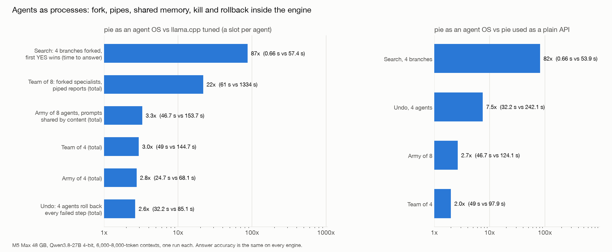

# pie as an operating system for agents

## The idea

An operating system lets many programs share one CPU: it switches between them, pages idle ones out of memory, lets them fork, share memory and talk through pipes. pie does the same for AI agents on one GPU. Each agent is a process with its own memory (its KV cache), and the engine gives agents the system calls an OS gives programs.

Systems that improve themselves run armies of specialist agents that fork to try ideas, report to each other, undo failed attempts and wait on tools. Engines built for one chat at a time (Ollama, llama.cpp) cannot do these things inside the engine, so every one of them costs a full re-read of the agent's context.



## OS features mapped onto pie

| OS feature | In pie | Where it lives |
|---|---|---|
| Process | An agent: a live program with its own KV cache and recurrent state | pie (existing) |
| Swap | Idle agents parked on SSD, restored when their tool returns | Engine branch `feat/idle-agent-eviction` |
| `fork()` with copy-on-write | A new agent shares every page of its parent; nothing is re-read | pie (existing), used by the team program |
| Shared memory / shared libraries | A common prompt is read once; other agents map it, named by a hash of its content, every 1,024 tokens | Private: `session/`, `serve.py` |
| Pipes | One agent's output goes into another's memory, token for token, inside the engine | In one process: private `team/`. Between processes: engine branch `feat/agent-pipes` (`send-to`) |
| `kill` and signals | Stop an agent mid-answer; its GPU time goes to the others | Private: `team/` |
| Checkpoint and rollback | Save an agent as a named fork; put it back exactly as it was | Private: `team/` |
| Readahead | Restore a parked agent just before its tool returns | Engine branch `feat/agent-prefetch` |

Engine branches are stacked on current main: `feat/idle-agent-eviction` (2 commits), then `feat/agent-prefetch`, then `feat/agent-pipes`. They are not pushed yet. The agent programs and harnesses (`team/`, `session/`, `serve.py`) are private, in the local repo at `~/pie-agents`.

## Results

Setup: M5 Max with 48 GB, Qwen3.8-27B 4-bit, contexts of 6,000–8,000 tokens. One run each. llama.cpp is tuned with one slot per agent, its best setting for these workloads.

| Workload | What the agents do | pie | llama.cpp tuned | pie faster by |
|---|---|---|---|---|
| Search | Fork 4 branches from an agent holding a notebook; the first branch to answer YES wins, the rest are killed | 0.66 s to answer | 57.4 s | **87x** |
| Team of 8 | A coordinator reads a notebook and forks 8 specialists; each makes 4 tool calls per round; reports are piped up and a summary is piped back; 2 rounds | 61 s | 1,334 s | **22x** |
| Army of 8 | 8 agents with OpenCode-style 8,000-token system prompts that differ only near the end; 5 turns each | 46.7 s | 153.7 s | **3.3x** |
| Team of 4 | As above, 4 specialists | 49.0 s | 144.7 s | 3.0x |
| Army of 4 | As above, 4 agents | 24.7 s | 68.1 s | 2.8x |
| Undo | 4 agents; at every step each tries a tool action that fails, rolls back and retries | 32.2 s | 85.1 s | 2.6x |

What the co-design adds on pie itself (pie as an agent OS, against the same engine used as a plain API where every agent reads everything itself and talks through the client):

| Workload | pie as agent OS | pie as plain API | Gain |
|---|---|---|---|
| Search, 4 branches | 0.66 s | 53.9 s | 82x |
| Undo, 4 agents | 32.2 s | 242.1 s | 7.5x |
| Army of 8 | 46.7 s | 124.1 s | 2.7x |
| Team of 4 | 49.0 s | 97.9 s | 2.0x |

Two of the mechanisms behind these numbers:
- **Starting a forked team.** 8 specialists started in 1.7–2.2 s on pie, against 101 s on llama.cpp, which re-reads the notebook once per specialist.
- **Mapping a shared prompt.** A new agent mapped a 10,300-token shared prompt in 0.45 s, against 17–27 s to read it.

## Ranked by how hard the advantage is to copy

The top rows are things llama.cpp and Ollama cannot do with any setting; the lower rows are gaps they could narrow by tuning or a feature update. The defensible claim is rows 1–3.

| Rank | Workload | pie | Best competitor | pie faster by | Can they match it? |
|---|---|---|---|---|---|
| 1 | **Many agents, each with its own long context, calling tools** (16 agents × 6,000 tokens) | 1.4 min | Ollama 25.7 min; llama.cpp tuned 28.7 min | **18–20x** | **No.** Their saved states live in RAM and get evicted, so they re-read. pie parks agents on SSD and restores in 0.15 s. More RAM did not save llama.cpp: it ran out of memory |
| 2 | **Longer contexts** (8 agents × 12,000 tokens) | 1.0 min | Ollama 22.4 min; llama.cpp 3.9 min | **22x / 3.9x** | **No.** Their re-read cost grows with context length; pie's does not |
| 3 | **Team of 8 sharing one document** (fork, tools, reports) | 61 s | llama.cpp tuned 1,334 s | **22x** | **No.** Each slot re-reads the document, and its cache collapses past about 9 agents. pie's forks share the pages |
| 4 | Branch search from one agent (4 branches) | 0.66 s | llama.cpp 57 s; **Ollama 1.05 s** | 87x / **1.6x** | **Partly.** Ollama's single slot reuses a shared prefix well; only the 1.6x is the honest number |
| 5 | OpenCode-style army, shared 8,000-token prompt (8 agents) | 47 s | llama.cpp 154 s | 3.3x | **Probably, with work.** llama.cpp has a unified-KV option that could share prefixes across slots; untested |
| 6 | Team of 4 | 49 s | llama.cpp 145 s | 3.0x | **Likely, by tuning.** 4 agents fit in its cache |
| 7 | Undo failed steps (4 agents) | 32 s | llama.cpp 85 s | 2.6x | **Mostly.** Its prefix cache already handles rollback in a slot |
| 8 | 1–2 agents | — | — | **None** | They are equal or slightly faster |

Rows 1 and 2 come from the tool-loop study (`TOOL-LOOP.md`), with pie on its default GPU pool.

## Where pie does not win, and what is unfinished

- **Ollama is good at search.** It serves this model one request at a time, so all branches share the parent's prompt as a prefix, which its prompt cache handles. pie is 1.6x faster there (0.66 s against 1.05 s), not 87x. Its weakness is many agents with different contexts; the tool-loop study measured it at 14–22x slower than pie there.
- **Prefetch gives no measurable gain.** On the default pool, 8 agents finished in 45–47 s with or without it, and only the slowest 10% of steps improved (4.9 s to 4.4 s). A restore from SSD already takes only about 0.15 s. The first version deadlocked with 8 agents; the fixed version only queues the restore and never pins memory.
- **Pipes between processes are built and checked, not benchmarked.** One process sent another a message inside the engine, and a send to another client's process was refused. Within the team program, pipes are part of every team result above.
- **llama.cpp failed search with 8 branches** (internal server error), so there is no 8-branch comparison.
- **The llama.cpp team-of-8 row (1,334 s)** comes from the run before the prompts started each answer with "The code word is". That run already scored 64 of 64; the other team rows use the final prompts.
- **Scope.**
  - Every result is one run on one machine with one dense model.
  - The army is OpenCode-shaped, not OpenCode itself: OpenCode's background service blocked when several copies ran at once.
- **Answer quality is the same on every engine.** Team 31–32 of 32, undo 16 of 16, search 2 of 3 everywhere; in the search misses, the model wrote something other than YES or NO.

## Not built yet

| Feature | Why not yet |
|---|---|
| Compressed swap (KV stored at 8 or 4 bits on SSD) | Large engine change; restores are already fast |
| Partial paging (only an agent's old context leaves the GPU) | Large planner change |
| Agents that survive an engine restart | Medium; not a speed gain |
| Per-agent memory quotas | Fairness feature, not speed |
| Priorities for the critical path | Medium; small expected gain at these sizes |
| Reusing a document read at a different position | Exact reuse is impossible: KV depends on everything before it. Approximate methods (CacheBlend-style) cost accuracy |

## Reproduce

```
cd ~/pie-agents
uv run --project pie/python/client python team.py team --specialists 8       # also: separate, llama, ollama
uv run --project pie/python/client python os_bench.py search team --branches 4
uv run --project pie/python/client python os_bench.py undo team --agents 4
./oc_serve.sh && uv run python army.py pie --agents 8                         # ./oc_serve.sh --no-share for the baseline
uv run python army.py llama --agents 8
uv run --with matplotlib python os_plot.py                                    # agent-os.png
```

Results land in `team.jsonl`, `os.jsonl` and `army.jsonl`.
