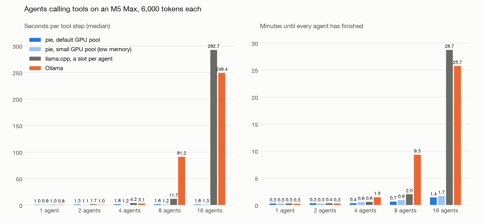
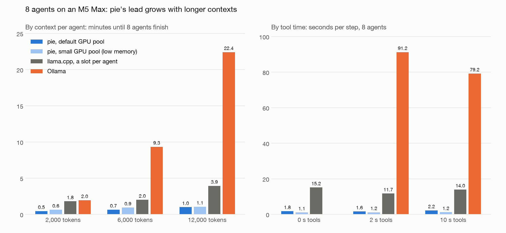

# Many agents calling tools on one laptop

## 1. The workload

An "army of agents": many agents share one local model. Each agent has its own long context (task, files, history) and spends most of its time waiting on tools such as search, compile, tests or an API.

One agent's loop:

1. Write a short tool call (about 16 tokens).
2. Wait while the tool runs (seconds).
3. Read the tool's output (about 120 tokens).
4. Repeat.

Two things matter: how long an agent waits for its next step, and how long the whole army takes to finish. Raw decode speed hardly matters, because each step generates only a few tokens.

## 2. The problem on a laptop: the multiplexing penalty

To continue an agent, the engine needs that agent's KV cache: the model's memory of everything the agent has read. On the 27B model, a 6,000-token context takes about 0.8 GB of KV (llama.cpp's figure).

A laptop cannot keep every agent's KV on the GPU, so engines take turns between agents. When an engine switches to an agent whose KV it no longer holds, it rebuilds that KV by re-reading the agent's whole context: 12–15 s for 6,000 tokens on this model, just to add 120 new tokens.

That re-read is the multiplexing penalty. It grows with each property of the workload:

| More of | The penalty grows because |
|---|---|
| Agents | More agents compete for the same memory, so more switches miss, and agents queue behind each other's re-reads. |
| Context per agent | Every miss re-reads the whole context, so 12k tokens costs twice what 6k does. |
| Tool calls | Every call is a switch: the agent leaves while its tool runs and comes back later. |

## 3. How other engines handle it

**Ollama 0.35**, the default for most laptop users:

- It serves this model one request at a time. Its log says "model architecture does not currently support parallel requests".
- A RAM prompt cache of up to 8 GiB saves some agents' state; past that, switches re-read from scratch.
- Agents queue behind each other, so one slow re-read delays all of them.

**llama.cpp** (llama-server, the engine inside Ollama), tuned by hand:

- `-np N` gives each agent its own slot, so agents run in parallel and keep their KV between steps.
- The RAM prompt cache still overflows at around 9 agents (832 MiB per saved agent), and at 16 agents it falls back to re-reads, the same as Ollama.
- Raising the cache to 24 GiB did not help at 8 agents (19.5 s per step, against 11.7 s with the default). At 16 agents it drove the Mac critically low on memory, and the run was stopped.
- A user has to know these flags; Ollama does not expose them for this model.

**MLX** was not measured for this workload.

## 4. What pie does differently

pie runs each agent as a program inside the engine, with its own KV.

- **No re-reads.** An agent's KV is never thrown away. When the GPU is short of memory, pie moves it to SSD and back.
  - A restore from SSD took 0.14–0.16 s on average, against 12–15 s to re-read the same context, so about 90x cheaper.
  - With the small pool at 16 agents, pie parked and restored agents 96 times in one run, almost once per tool call. With the default pool it was 86 times.
- **Idle agents give way.** An agent waiting on its tool gives up its GPU memory first, so busy agents never wait on idle ones.
- **Agents that are ready generate together.** Steps from many agents run as one batch, so a step costs about the same at 16 agents as at 1.

## 5. What the branch adds

Branch `feat/idle-agent-eviction`, two commits on current main:

1. `runtime: a process waiting on its client is evicted first and restores when it wakes`

| Change | Why it is needed |
|---|---|
| A program waiting for a message is marked idle while it waits. | Otherwise the engine cannot tell an agent waiting on a tool from one in the middle of a step. |
| Idle programs are evicted first, whatever their age. | Stock pie only evicts programs younger than the one waiting. An older idle agent holds its memory forever, and the run stalls: on main, 4 agents in this loop made no progress for over 10 minutes. |
| An idle eviction does not queue a restore until the program wakes. | Otherwise pie would restore an agent that is still waiting on its tool, only to evict it again. |
| Waking queues the restore ahead of the program's next step. | The KV is back by the time the agent needs it. |

2. `runtime: pages an idle process holds do not count as kv pressure at admission`

| Change | Why it is needed |
|---|---|
| Pages held by idle agents count as free when the gateway decides whether to admit a new launch. | The gateway holds a launch while the GPU pool is over about 94% full and waits for room. Only an eviction makes room, and with every agent idle nothing asks for one. With small contexts, or a large pool, pie froze while launching agents (seen at 8 agents × 2,000 tokens and 16 agents × 6,000 tokens). Both runs now complete. |

Size: 2 files, about 130 lines, with one planner test. Runtime tests (41), clippy and fmt pass.

The idea started on `test/agent-kv-residency`. That branch also carries an admission queue, host-RAM KV swap and prefix-cache work. Main has since gained its own SSD spill for KV, so only the idle-eviction part was ported, and the hang above was found and fixed along the way.

## 6. Results

Setup:
- M5 Max with 48 GB, Qwen3.8-27B 4-bit, greedy decoding.
- Each agent holds 6,000 tokens and makes 6 tool calls; each tool takes 2 s.
- All agents loop at once.

pie is shown in two configurations, both measured on this Mac:

| | GPU pool for agents' memory | What it represents |
|---|---|---|
| **pie, default pool** | Sized automatically from free GPU memory. It holds several agents, so parking starts only at around 8 agents. | This M5 Max as it ships. The main result. |
| **pie, small pool** | 8,192 tokens, one agent's worth, so pie parks agents on SSD on almost every step. | A Mac where the model's weights leave little room for agents' memory, for example a 24 GB Mac running this 27B model. |

The small pool shows how pie degrades when memory is short. The competitors were not squeezed the same way, so that column is not a like-for-like contest with them.

Each row is one run. For the small pool, the 8- and 16-agent rows are the mean of 3 runs, which agreed within 10%.

### Scaling with the number of agents



Minutes until every agent has finished:

| Agents | pie, default pool | pie, small pool | llama.cpp tuned | Ollama |
|---|---|---|---|---|
| 1 | 0.3 | 0.3 | 0.3 | 0.3 |
| 2 | 0.3 | 0.3 | 0.4 | 0.3 |
| 4 | 0.4 | 0.6 | 0.6 | 1.5 |
| 8 | 0.7 | 0.9 | 2.0 | 9.3 |
| 16 | 1.4 | 1.7 | 28.7 | 25.7 |

Seconds per tool step (median):

| Agents | pie, default pool | pie, small pool | llama.cpp tuned | Ollama |
|---|---|---|---|---|
| 1 | 1.0 | 0.9 | 1.0 | 0.8 |
| 2 | 1.3 | 1.1 | 1.7 | 1.0 |
| 4 | 1.8 | 1.2 | 4.2 | 3.1 |
| 8 | 1.6 | 1.2 | 11.7 | 91 |
| 16 | 1.6 | 1.3 | 293 | 249 |

llama.cpp tuned means one slot per agent.

**With the default pool, at 16 agents pie finishes 18x sooner than Ollama and 20x sooner than tuned llama.cpp. At 8 agents it is 14x and 3x.**

Steps take a little longer with the default pool than with the small one (1.6 against 1.2 s at 8 agents). More agents are on the GPU at once and step together in one batch, so each step carries more work. The total still finishes sooner, because fewer agents wait for a restore.

### Longer contexts and tool time (8 agents)



Minutes until every agent has finished:

| Context per agent | pie, default pool | pie, small pool | llama.cpp tuned | Ollama | pie (default) lead over Ollama | over llama.cpp |
|---|---|---|---|---|---|---|
| 2,000 tokens | 0.5 | 0.6 | 1.8 | 2.0 | 4x | 4x |
| 6,000 tokens | 0.7 | 0.9 | 2.0 | 9.3 | 14x | 3x |
| 12,000 tokens | 1.0 | 1.1 | 3.9 | 22.4 | 22x | 3.9x |

Seconds per tool step (median):

| Tool time | pie, default pool | pie, small pool | llama.cpp tuned | Ollama |
|---|---|---|---|---|
| 0 s | 1.8 | 1.1 | 15.2 | not measured |
| 2 s | 1.6 | 1.2 | 11.7 | 91 |
| 10 s | 2.2 | 1.2 | 14.0 | 79 |

- pie's step time stays at 1–2 s whatever the context or tool time; the competitors' grows with context.
- Over Ollama the lead grows from 4x to 22x as contexts go from 2k to 12k tokens.

### Other setups

| Setup, 8 agents | Step | Total |
|---|---|---|
| llama.cpp, one slot (Ollama's mode without Ollama) | 68 s | 7.1 min |
| llama.cpp, a slot per agent, 24 GiB prompt cache | 19.5 s | 3.0 min |
| pie, a pool sized by hand for 8 agents (no parking) | 3.4 s | 0.5 min |
| pie, the same hand-sized pool with 16 agents | 3.4 s | 1.2 min |

A pool sized by hand to hold every agent is the fastest pie setup: 0.5 min at 8 agents, against 0.7 with the default pool. pie's automatic sizing leaves room unused on this Mac.

## 7. Trade-offs and limits

- **No gain at 1–2 agents.** With one agent Ollama is slightly faster (0.8 s against 0.9 s per step). The advantage starts at around 4 agents.
- **Memory is similar, not lower.** System memory growth was 17–35 GB for pie, 18–38 GB for llama.cpp and 22–36 GB for Ollama, depending on agent count. pie's gain is time, not RAM.
- **SSD files.** pie's KV files on SSD took 16–64 GB per run, even in runs that parked nothing; their size follows the configured budget, not what is parked. They also grow past what they hold, a known, unfixed bug: they once reached 328 GB. This must be fixed before shipping.
- **Burst on mass wake-up.** When every agent wakes at once, the first step waits for restores. With the default pool that is 1.3 s at 8 agents and 17 s at 16 (median of first steps); with the small pool, 12 s and 41 s. Later steps are back to 1–2 s.
- **Answer quality is set by the model, not the engine.** Each engine had one agent whose text the model answered badly, in every run:
  - pie: agent 11 (5 of 96 wrong at 16 agents). It fails the same way when run completely alone, so it is not caused by switching.
  - llama.cpp: agent 3 answers in prose.
  - Ollama: agent 7 at 12,000 tokens.

  The engines use different 4-bit builds of the model (MLX for pie, GGUF for the others).
- **Scope.** One machine, one dense model. The expert (MoE) model and other Macs were not tested.

## 8. Reproduce

```
cd ~/pie-agents
uv run --project pie/python/client python tools.py pie --agents 8 --config pie-full.toml
uv run --project pie/python/client python tools.py llama --agents 8 --slots 8
uv run --project pie/python/client python tools.py ollama --agents 8
uv run --with matplotlib python plot.py      # draws tools.png and tools-sweeps.png
```

- Options: `--context`, `--tool`, `--steps` and `--config`: `pie-full.toml` for the default pool, `pie.toml` for the small pool, `pie-16k.toml` for the small pool at 12k contexts, and `pie-wide.toml` for the hand-sized pool.
- Each run appends a row to `tools.jsonl`.
- pie runs need the `feat/idle-agent-eviction` build at `pie-mpp/target/release/pie`.
