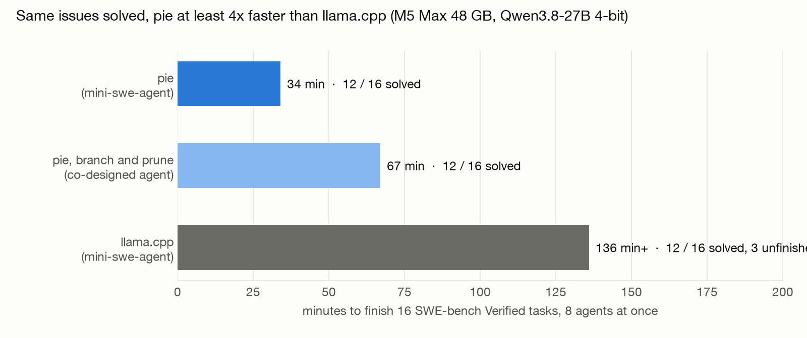

# Many coding agents on one laptop: SWE-bench Verified on pie vs llama.cpp

## Summary

Eight coding agents ran at once on one MacBook (M5 Max, 48 GB), each fixing a real GitHub issue from SWE-bench Verified, scored by the official SWE-bench harness. Same model (Qwen3.8-27B, 4-bit), same agent (mini-swe-agent), same 16 tasks.

| | pie | llama.cpp |
|---|---|---|
| Issues solved (official scoring) | **12 of 16** | 12 of 16 |
| Time for the batch | **34 min, all 16 finished** | 2 h 16 min, 3 still unfinished, then stopped |
| Median time per finished task | **445 s** | 926 s |
| Time per agent step | **~22 s** | ~68 s |

**Same quality, at least 4x faster.** llama.cpp had not finished when stopped at 4x pie's total time, so 4x is a floor.

**The co-designed agent did not help on this benchmark.** pie-code with branch and prune (2 forked attempts per task, first submitted patch wins, the other killed) also solved 12 of 16, but took 67 minutes against plain pie's 34:

| | pie, plain (8 agents) | pie, branch and prune (8 tasks x 2 attempts) | llama.cpp (8 agents) |
|---|---|---|---|
| Solved | 12 / 16 | 12 / 16 | 12 / 16 |
| Time | **34 min** | 67 min (incl. a 15-min stall on the last 2 tasks) | 136+ min, unfinished |

On a memory-bound machine a second attempt per task halves the tasks that progress at once and squeezes the KV pool. Pruning worked (losers stopped within about 20 s of the winner) and the attempts shared their prompt (the second mapped 2,048 tokens instead of reading them), but these tasks are easy enough that one attempt usually succeeds, so a second buys nothing.

## The setup

- **Tasks:** 16 SWE-bench Verified tasks rated "under 15 minutes to fix", spread over 11 repositories (astropy, django, matplotlib, flask, requests, xarray, pylint, pytest, scikit-learn, sphinx, sympy). Each agent runs in that task's official Docker image; on Apple Silicon the x86 images run under emulation, the same for both engines.
- **Agent:** mini-swe-agent 2.4.6, text-based (one bash command per reply), 40-step limit, temperature 0, thinking off. This model scores 86% on the SWE-bench Verified leaderboard with it.
- **Concurrency:** 8 agents at once; a new task starts when one finishes.
- **Scoring:** the official SWE-bench harness (5.0.2) runs each task's hidden tests against the agent's patch.
- **Equal memory:** about 24 GB of GPU memory per engine.
  - llama.cpp: one slot per agent (8 × 32k tokens) with 8-bit KV, its standard memory-saving option.
  - pie: 16-bit KV (the only build of this model it has), a 1,536-page pool (49k tokens) plus 20 recurrent-state slots; agents that do not fit are parked on SSD.
  - The agents reach pie through our OpenAI-compatible proxy (`serve.py`): one live pie session per agent, which keeps the agent's memory between steps.

## Why pie is faster

- **pie never re-reads an agent's history.** Each agent is a live session that keeps its KV between steps; a step only reads the new tool output. Over the run pie reused 3.76M tokens from memory and read only 0.23M fresh: 94% of the reading avoided. Median time to a reply was 11.7 s with 8 agents active.
- **llama.cpp keeps re-reading.** This model mixes attention with recurrent layers, so llama.cpp saves and restores whole agent states through its RAM prompt cache, about 5 GB each. Its log shows the cache constantly evicting them (`making room for prompt cache entry, removing oldest entry (size = 5153 MiB)`), after which an agent's whole history must be read again. Its slowest task took 93 minutes.

## What broke overnight, and what was fixed

The first attempts ran 16 agents at once and failed. Each failure is a real finding:

| Problem | Cause | Fix |
|---|---|---|
| Agents duplicated themselves | mini-swe-agent's client timed out after 600 s and retried, starting a second session for the same agent | Client timeout 1 h, no retries (both engines) |
| 16 agents starved | pie's default KV pool is 1,024 pages (32k tokens) for 16 agents of 10-20k tokens each: 13 of 16 parked, restores queued | Pool sized explicitly |
| GPU out of memory mid-run at 16 agents | GPU memory on a Mac is shared with Docker's VM, which grows as 16 containers run test suites; pools that pass pie's boot check fail 20 minutes later | 8 agents at once on both engines, equal memory |
| New tasks never started (B8, first try) | The proxy never closed finished conversations, and pie's planner does not admit a new process while an older one is preempted, so 6 new sessions waited forever | The proxy keeps at most agents + 2 sessions, closing the oldest idle one. The engine side is open (see below) |
| Scoring crashed | swebench 5.0.2 needs the `SWE-bench/SWE-bench_Verified` dataset, which carries image and eval-script fields | Switched datasets |

Also found: pie's `[engine] gpu_mem_utilization` is read at boot but a later memory check uses the default 0.9.

## Caveats

- One run per engine, 16 easy tasks. Solve rates of 12/16 are not distinguishable from each other; the claim is equal quality, not better quality.
- The engines run different 4-bit builds (MLX for pie, GGUF Q4_K_M for llama.cpp). Agents on pie took more steps per task (median 27 vs 19), so the per-task speedup (2.1x) is smaller than the per-step one (3x).
- pie's KV is 16-bit and llama.cpp's 8-bit, so per token pie holds half as much in the same memory. An 8-bit build of the model for pie would raise its capacity; it was not available.
- llama.cpp was stopped at 2 h 16 min with 3 tasks unfinished; they count as unsolved. Its true batch time is longer than reported.
- 16 agents at once could not be run reliably on this 48 GB Mac with 16 containers, on pie (GPU out of memory) or llama.cpp (system memory pressure). 8 is the number this machine sustains.

## Open engine work

1. **Admission behind preempted idle processes.** A new process waits while any older process is preempted. Sessions that will never run again (a finished agent) can block new ones indefinitely. The planner should not hold admission for processes that are idle, or should evict them.
2. **`gpu_mem_utilization` ignored by the second memory check.**
3. **Batch working memory is not counted** when sizing the pool, so a pool that passes the boot check can run the GPU out of memory under load.
4. **An 8-bit-KV build** of this model would double the agents pie keeps resident.

## Earlier results this complements

- Tool-loop and team benchmarks (`TOOL-LOOP.md`, `AGENT-OS.md`): 16 agents with long private contexts, 18-20x faster than Ollama and tuned llama.cpp; fork-based teams 22x and branch search 87x faster than llama.cpp.
- Real OpenCode through the proxy: one agent fixed a bug in 24.5 s on pie (21.5 s on llama.cpp). With 8 agents, llama.cpp took 280 s; pie runs above 2 agents could not be completed because OpenCode's own server wedged under concurrency. Shared prompts worked on OpenCode's real prompts: new agents mapped 8,192-8,352 of 8,399 tokens instead of reading them.
